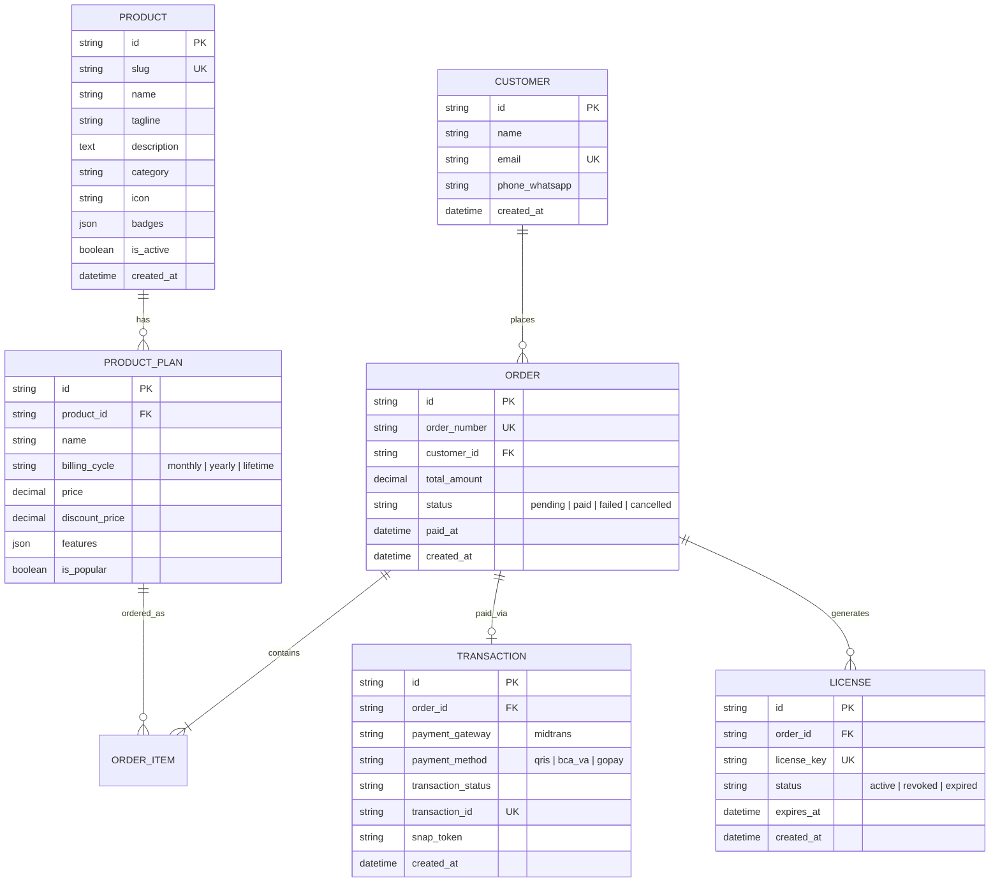

# 🏗️ Infrastructure & Architecture Document — Store Mituni

> **Nama Proyek**: Store Mituni  
> **Versi**: 1.0.0  
> **Terakhir Diperbarui**: Oktober 2026  
> **Lingkup**: Arsitektur Sistem, Tumpukan Teknologi, Alur Pembayaran, Pengiriman Lisensi, & Strategi Deployment  

---

## 1. Arsitektur Tingkat Tinggi (High-Level Architecture)

```
[ Pengguna Web / Mobile ]
         │
         ▼  (HTTPS / CDN Edge)
┌─────────────────────────────────────────────────────────────┐
│                 Next.js 16 (App Router)                     │
│  - React 19 Server Components (RSC)                         │
│  - Route Handlers (/api/checkout, /api/webhooks/*)          │
│  - Tailwind CSS v4 + Base UI + Shadcn UI                    │
└───────┬─────────────────────────┬───────────────────────────┘
        │                         │
        ▼ (Database Query)        ▼ (REST / Webhook)
┌───────────────────────┐   ┌─────────────────────────────────┐
│ PostgreSQL / Supabase │   │      Payment Gateway            │
│ - Products & Plans    │   │      (Midtrans Snap / Core)     │
│ - Orders & Invoices   │   └─────────────────────────────────┘
│ - Licenses & Keys     │                 │
│ - Customers & Leads   │                 ▼ (Webhook Event)
└───────────────────────┘   ┌─────────────────────────────────┐
                            │    Notification & Delivery      │
                            │  - Kilex WhatsApp Gateway API   │
                            │  - Email Service (Resend/SMTP)  │
                            └─────────────────────────────────┘
```

---

## 2. Tumpukan Teknologi (Technology Stack)

| Lapisan | Teknologi | Versi | Alasan Pemilihan |
| :--- | :--- | :--- | :--- |
| **Framework Web** | **Next.js (App Router)** | `16.4.2` | Kinerja server-side rendering maksimal, SEO optimal untuk halaman produk, efisiensi caching. |
| **Bahasa** | **TypeScript** | `^5.0` | Keamanan tipe data end-to-end pada transaksi dan pemetaan katalog produk. |
| **Runtime UI** | **React** | `19.3.1` | Fitur React Server Components, Actions, dan reaktivitas modern. |
| **Styling & Theme** | **Tailwind CSS v4** | `^4.0` | Performa kompilasi secepat kilat dengan engine berbasis CSS native, didukung `tw-animate-css`. |
| **Komponen UI** | **Base UI & Shadcn UI** | `@base-ui/react` `^1.9` | Aksesibilitas tingkat WAI-ARIA, desain elegan, modular, dan dapat dikustomisasi penuh. |
| **Visual & Charts** | **Recharts & Lucide React** | `3.8.0` / `1.59.0` | Menampilkan visualisasi data statistik, perbandingan harga, dan grafis interaktif. |
| **Sintaks & Kode** | **Shiki** | `^4.5` | Penyorot sintaks kode berkecepatan tinggi untuk dokumentasi integrasi API dan developer tools. |
| **Payment Gateway** | **Midtrans API** | *Snap / Core API* | Dukungan metode pembayaran terlengkap di Indonesia (QRIS, VA Bank, E-Wallet). |
| **Notifikasi WA** | **Kilex WA Gateway** | *Internal REST* | Mengirim notifikasi transaksi dan lisensi instan langsung ke nomor WhatsApp pembeli. |
| **Manajemen Proses** | **PM2 / Node.js** | LTS (v20+) | Menjamin ketersediaan aplikasi non-stop pada deployment berbasis VPS. |

---

## 3. Desain Model Data (Data Modeling)



---

## 4. Alur Integrasi Pembayaran & Penerbitan Lisensi

1. **Pemilihan Produk & Checkout**:
   - Pembeli memilih paket produk digital pada antarmuka Store Mituni.
   - Pembeli memasukkan detail kontak: Nama, Email, dan Nomor WhatsApp.
2. **Pembuatan Transaksi (Server Action / Route Handler)**:
   - Sistem memvalidasi payload dan membuat catatan `Order` berstatus `pending`.
   - Mengirim permintaan pembuatan transaksi ke Midtrans via Snap API (`/api/checkout`).
   - Token pembayaran dikembalikan ke frontend dan modal pembayaran muncul.
3. **Penyelesaian Pembayaran & Webhook**:
   - Pembeli menyelesaikan pembayaran (misal: memindai QRIS atau transfer VA).
   - Server Midtrans mengirim notifikasi HTTP POST ke `/api/webhooks/midtrans`.
   - Server Store Mituni memvalidasi tanda tangan kriptografi `signature_key`:
     $$\text{SHA512}(\text{order\_id} + \text{status\_code} + \text{gross\_amount} + \text{ServerKey})$$
4. **Eksekusi Pengiriman Otomatis**:
   - Setelah status tervalidasi `settlement` atau `capture`:
     - Status `Order` diubah menjadi `paid`.
     - Lisensi digital (`LICENSE_KEY`) di-*generate* secara acak dengan format aman (`MITUNI-XXXX-XXXX-XXXX`).
     - Mengirim payload ke **Kilex WhatsApp Gateway**: mengirim pesan konfirmasi ramah berisi bukti bayar, kunci lisensi, serta tautan repositori/aplikasi.
     - Mengirim surel faktur resmi ke email pembeli.

---

## 5. Strategi Deployment & Infrastruktur Server

Aplikasi Store Mituni disiapkan untuk berjalan secara fleksibel pada lingkungan VPS mandiri maupun platform PaaS modern:

### Opsi A: Deployment Mandiri (Ubuntu VPS + Nginx + PM2)
* **Kebutuhan Minimum**: VPS 2 Core CPU, 2 GB RAM, SSD 25 GB (Ubuntu 22.04 / 24.04 LTS).
* **Nginx Reverse Proxy**:
  * Menangani termination SSL (Let's Encrypt / Certbot).
  * Proxy ke port lokal aplikasi Next.js (default port `3000`).
  * Konfigurasi gzip / brotli compression dan caching header untuk aset statis (`/_next/static/`).
* **Manajemen Proses (PM2)**:
  * Berkas konfigurasi `ecosystem.config.cjs` untuk menjalankan Next.js dalam mode cluster / fork dengan auto-restart saat terjadi memory leak atau crash.

### Opsi B: Cloud PaaS (Vercel)
* *Zero-configuration deployment* dengan integrasi otomatis ke GitHub.
* Global Edge Network untuk latency tercepat ke seluruh wilayah Indonesia.

---

## 6. Pengamanan & Keandalan (Security & Reliability)

1. **Proteksi Kunci Rahasia**:
   - Kunci server Midtrans, token WhatsApp Gateway, dan kredensial database disimpan murni pada variabel lingkungan (`.env.local`) yang tidak dilacak Git.
2. **Idempotency Webhook**:
   - Penanganan notifikasi pembayaran memastikan satu `order_id` yang sama tidak diproses dua kali guna mencegah duplikasi pengiriman lisensi.
3. **Rate Limiting**:
   - Membatasi frekuensi request ke endpoint checkout dan integrasi WhatsApp guna mencegah eksploitasi spam atau brute-force.
4. **Activity Sync Portfolio Monitoring**:
   - Setiap pembaruan atau penambahan fitur yang berdampak pada pengguna disinkronkan langsung ke dashboard portofolio publik (`https://ajoroby.is-a.dev/api/activities`) sesuai aturan baku proyek.
